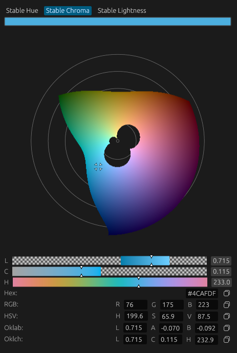

# egui_oklch_color_picker

An OKLCH color picker library for `egui`.

`egui_oklch_color_picker` provides interactive color picker widgets built around the perceptually uniform **OKLab** and **OKLCH** color spaces. It is designed to integrate naturally with existing `egui` applications while offering more perceptually meaningful color editing than traditional RGB- or HSV-based pickers.

The live demo can be accessed here: [timomillenaar.nl/oklch_color_picker](https://www.timomillenaar.nl/oklch_color_picker/)

The documentation can be found at docs.rs



## Features

* Interactive color picker in Oklch color space for perceptually uniform color spaces
* OKLab and OKLCH color types
* `egui`-style color edit button
* Embedded color picker widget
* Popup color picker on arbitrary `egui` elements
* Optional alpha channel support
* Seamless conversion to and from `egui::Color32` and `egui::Rgba`
* Optional `serde` support

## Crates

| Crate                     | Description                                                                       |
| ------------------------- | --------------------------------------------------------------------------------- |
| `egui_oklch_color_picker` | Library containing the widgets, color types, and conversion utilities.            |
| `demo`                    | Example application demonstrating the available widgets and integration patterns. |

## Quick Example

```rust
let mut color = egui_oklch_color_picker::Oklch::default();
let widget_width = 270.;
egui_oklch_color_picker::color_edit_button_oklch(
    ui,
    &mut background_color,
    widget_width,
    "background_color_picker"
);
```

## Running locally

You can run the demo locally via:

```sh
cargo run -p demo --release
```

Or launch the web version locally:

```sh
cd demo
trunk serve --release
```

## License

This software is freely available under an MIT license
