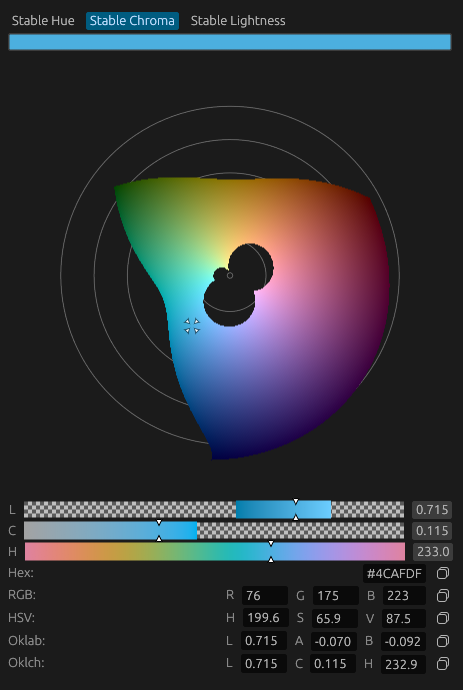

# egui_oklch_color_picker

An OKLCH color picker for `egui`.

`egui_oklch_color_picker` provides interactive color picker widgets based on the perceptually uniform **OKLCH** color spaces. It includes embedded pickers, popup pickers, and color edit buttons, along with conversion types for working with OKLab and OKLCH colors.



## Features

* OKLab and OKLCH color types
* Embedded 2D color picker
* Popup color picker
* Color edit button with popup picker
* Optional alpha channel support
* Compatible with `egui::Color32` and `egui::Rgba`
* `serde` support (optional)

## Quick Example

```rust
let mut color = egui_oklch_color_picker::Oklch::default();
let widget_width = 270.;
egui_oklch_color_picker::color_edit_button_oklch(
    ui,
    &mut background_color,
    widget_width,
    "background_color_picker"
);
```

For more complete examples, see the `demo` crate included in this repository (https://github.com/tmillenaar/egui_oklch_color_picker/tree/main/demo)

## License

This software is freely available under an MIT license
